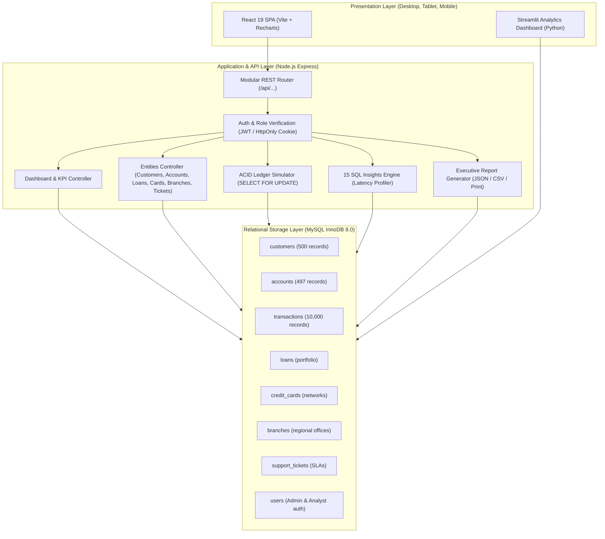

# 🏦 BankSight: Transaction Intelligence Dashboard

[](https://github.com/sharmapriya18504-dotcom/Banksight)
[](https://www.python.org/)
[-orange.svg)](https://www.mysql.com/)
[](LICENSE)
[]()

> **BankSight** is a high-performance, industry-grade banking analytics and transaction intelligence platform engineered to transform complex relational financial ledgers into actionable executive intelligence, credit risk monitoring, and automated ACID ledger operations. 
> 
> BankSight features **two complete, production-ready implementations**:
> 1. **Modern Enterprise Full-Stack Application (v2.0):** React 19 + Vite, Recharts, React Router, Vanilla CSS, Node.js Express REST API, bcrypt auth, and MySQL InnoDB.
> 2. **Python Data Science Analytics Application:** Streamlit, Pandas, Plotly Express & Graph Objects, and MySQL Connector.

---

## 📌 Executive Summary & Problem Statement

Commercial retail banks process tens of thousands of financial operations daily across core deposit accounts, branch teller counters, lending desks, and digital payment gateways. Fragmented data architectures frequently result in:
1. **Delayed Executive Visibility:** Inability to track liquidity, net cash flow, and failure spikes in real-time.
2. **Hidden Credit & Fraud Risks:** Undetected transaction failure clusters and high-velocity fraud patterns.
3. **Ledger Inconsistency:** Disconnected simulation tools that bypass ACID double-entry audit standards.

**BankSight** resolves these issues by unifying **7 relational banking entities** into an interactive intelligence hub featuring:
- **8 Real-Time Executive KPIs** calculated dynamically from the live database.
- **15 Verified SQL Analytical Insights** covering customer lifetime value, branch revenue, lending risk, and fraud surveillance.
- **ACID-Compliant Ledger Simulator** with row-level locks (`SELECT ... FOR UPDATE`), balance checks, and atomic commits.
- **Enterprise CRUD Workflows** enforcing strict Foreign Key constraints and parameterized SQL safety.
- **Role-Based Authentication** separating Administrative operators (`admin`) from read-only Risk Analysts (`analyst`).

---

## 🛠 Technology Stack

| Layer | Component | Technologies Used | Description |
|---|---|---|---|
| **Frontend UI (v2.0)** | React 19 + Vite | React.js, React Router, Recharts, Lucide Icons, Vanilla CSS | Dark navy fintech theme (`#070c18`), glassmorphic panels, responsive layouts for desktop, tablet, and mobile |
| **Backend REST API (v2.0)** | Node.js + Express.js | Express 4, `mysql2/promise`, `bcryptjs`, `jsonwebtoken`, `cookie-parser` | Modular routes, parameterized SQL queries, JWT & HttpOnly cookies, auto-migrations |
| **Data Science UI (Python)** | Streamlit + Plotly | Streamlit, Pandas, Plotly Express, Plotly Graph Objects | Interactive sliders, multi-attribute filters, dual-axis financial trend charts |
| **Database Engine** | MySQL 8.0 / 9.5 | InnoDB Engine, ACID Transactions, Row Locking | Relational storage across 8 tables with foreign-key referential integrity |
| **Security & Config** | Environment Variables | `dotenv`, `.env.example`, `.gitignore` | Zero credential leakage; separated database passwords and JWT secrets |

---

## 🏗 System Architecture



---

## 📂 Project Structure

```text
banksight/
├── frontend/                     # React 19 + Vite Single Page Application
│   ├── src/
│   │   ├── components/           # Header, Sidebar, Navbar
│   │   ├── context/              # AuthContext (login, signup, logout, role check)
│   │   ├── layouts/              # AppLayout (Header, Sidebar, Outlet)
│   │   ├── pages/                # 12 Main Navigation Pages
│   │   │   ├── LoginPage.jsx     # Authentication portal with 1-click Demo credentials
│   │   │   ├── SignupPage.jsx    # Public Analyst registration
│   │   │   ├── DashboardPage.jsx # 8 KPIs & Recharts interactive charts
│   │   │   ├── CustomersPage.jsx # Search, filters, Customer 360 inspect drawer, Admin CRUD
│   │   │   ├── AccountsPage.jsx  # Deposit accounts ledger & liquidity distribution
│   │   │   ├── TransactionsPage.jsx # Full journal, date range slicer, CSV export
│   │   │   ├── LoansPage.jsx     # Active facilities, interest rates, status filters
│   │   │   ├── CreditCardsPage.jsx # Utilization progress bars, network distribution
│   │   │   ├── BranchesPage.jsx  # Regional offices, revenue rank, employee counts
│   │   │   ├── SupportTicketsPage.jsx # SLAs, turnaround days, CSAT satisfaction
│   │   │   ├── InsightsPage.jsx  # 15 SQL Insights engine with live latency tracking
│   │   │   ├── SimulationPage.jsx # ACID ledger simulator with row-level locks
│   │   │   ├── ReportsPage.jsx   # Executive report generator with JSON/Print export
│   │   │   └── AboutPage.jsx     # Schema fixes, cloud deploy guide, interview outline
│   │   ├── utils/                # Currency (₹ INR), number, and date formatters
│   │   ├── config.js             # Dynamic API base URL configuration
│   │   ├── App.jsx               # React Router configuration
│   │   ├── main.jsx              # Application entry point
│   │   └── index.css             # Vanilla CSS design tokens, glassmorphism, responsive styles
│   └── package.json
│
├── backend/                      # Node.js + Express REST API Server
│   ├── config/
│   │   ├── db.js                 # MySQL2 promise connection pool & health diagnostics
│   │   └── migrate.js            # Auto-migration runner & initial user seeder
│   ├── middleware/
│   │   ├── auth.js               # JWT verification, HttpOnly cookie extraction, role guard
│   │   └── errorHandler.js       # Centralized error handler returning clean JSON
│   ├── routes/
│   │   ├── auth.routes.js        # Login, signup, logout, session /me
│   │   ├── dashboard.routes.js   # Real-time KPIs, monthly trends, flow, balances
│   │   ├── entities.routes.js    # Customers, accounts, transactions, loans, cards, branches, tickets
│   │   ├── insights.routes.js    # 15 Schema-verified SQL queries
│   │   ├── simulation.routes.js  # Atomic credit/debit with row locking (SELECT FOR UPDATE)
│   │   └── reports.routes.js     # Macro executive summary aggregation
│   ├── migrations/
│   │   └── 001_create_users_table.sql # Safe migration for authentication
│   ├── server.js                 # Unified entry point; serves API & React build
│   └── package.json
│
├── docs/                         # Comprehensive Technical Documentation
│   ├── database-schema.md        # Complete relational table schema & discrepancy fixes
│   ├── api-documentation.md      # Full REST API payload & query parameter specifications
│   └── deployment-guide.md       # Step-by-step local, Render.com & Railway deployment guide
│
├── app.py                        # Streamlit Python analytics entry point
├── db.py                         # Python MySQL connector pool
├── helpers.py                    # Python formatting and query execution helpers
├── queries.py                    # 15 Python SQL queries catalog
├── crud.py                       # Python CRUD operations with FK checks
├── simulate.py                   # Python ACID credit/debit simulation engine
├── requirements.txt              # Python production dependencies
├── tests/
│   ├── test_queries.py           # Automated unit tests for all 15 SQL queries
│   └── test_validation.py        # Automated unit tests for simulation rules
├── .env.example                  # Environment variable configuration template
├── .gitignore                    # Git ignore rules (.env, node_modules, dist)
└── package.json                  # Root orchestration scripts
```

---

## ⚡ How to Run Locally

### Option A: Modern React + Node.js Full-Stack App (Recommended)

1. **Configure Environment Variables:**
   Create a `.env` file in the project root (copied from `.env.example`):
   ```env
   DB_HOST=localhost
   DB_PORT=3306
   DB_USER=root
   DB_PASSWORD=your_mysql_password
   DB_NAME=banksight
   PORT=5000
   JWT_SECRET=your_jwt_secret_key_2026
   ```

2. **Single-Command Launch (Unified Production Architecture):**
   ```bash
   npm install
   npm run build
   npm start
   ```
   Open **`http://localhost:5000`** in your browser.

3. **Development Mode with Hot-Reloading:**
   - Terminal 1: `npm run server` (runs Express backend on `http://localhost:5000`)
   - Terminal 2: `npm run client` (runs Vite frontend on `http://localhost:5173`)

---

### Option B: Python + Streamlit Analytics App

1. **Install Python Dependencies:**
   ```bash
   pip install -r requirements.txt
   ```

2. **Run Automated Test Suite (11/11 Passing):**
   ```bash
   python -m unittest discover tests
   ```

3. **Start Streamlit Dashboard:**
   ```bash
   streamlit run app.py
   ```
   Open **`http://localhost:8501`** in your browser.

4. **Prepare for Project Viva & Evaluation:**
   Review the comprehensive viva manual: [docs/VIVA_PREPARATION_GUIDE.md](file:///c:/Users/Priya%20Sharma/Banksight/docs/VIVA_PREPARATION_GUIDE.md) containing 25+ essential viva questions, database normalization notes, and architecture diagrams.

---

## 🔑 Demo Login Credentials (React/Express Full-Stack App)

The application is seeded automatically with two demonstration accounts for evaluation:

| Role | Username | Password | Permissions |
|---|---|---|---|
| **Administrator** | `admin` | `Admin@123` | Full access: Add/Delete Customers, Execute ACID Ledger Simulation, Inspect all entities. |
| **Risk Analyst** | `analyst` | `Analyst@123` | Read-only analytics access: Dashboard, 15 SQL Insights, Reports, Inspection Drawers. |

*(The Login screen features **1-click quick fill buttons** to sign in instantly during portfolio reviews).*

---

## 💡 The 15 Standardized SQL Analytical Insights

Every insight is executed directly on the live MySQL database with real latency tracking:

| # | Official Requirement Question | Business Domain | Key Tables Joined | Primary Metric / Output |
|---|---|---|---|---|
| **Q01** | *How many customers exist per city, and what is their average account balance?* | Customer & Account | `customers`, `accounts` | Customer counts & average balance per city |
| **Q02** | *Which account type (Savings, Current, Loan, etc.) holds the highest total balance?* | Customer & Account | `customers`, `accounts` | Savings vs Current total balance rank |
| **Q03** | *Who are the top 10 customers by total account balance across all account types?* | Customer & Account | `customers`, `accounts` | Top 10 HNWI liquid depositors |
| **Q04** | *Which customers opened accounts in 2023 with a balance above ₹1,00,000?* | Customer & Account | `customers`, `accounts` | High-value accounts opened in 2023 |
| **Q05** | *What is the total transaction volume (sum of amounts) by transaction type?* | Transaction Behavior | `transactions` | Sum of amounts and counts by txn type |
| **Q06** | *How many failed transactions occurred for each transaction type?* | Transaction Behavior | `transactions` | Failed counts, lost volume, % failure share |
| **Q07** | *What is the total number of transactions per transaction type?* | Transaction Behavior | `transactions` | Transaction count and market share % |
| **Q08** | *Which accounts have 5 or more high-value transactions above ₹20,000?* | Transaction Behavior | `transactions`, `customers` | High-velocity large transaction accounts |
| **Q09** | *What is the average loan amount and interest rate by loan type?* | Loan Insights | `loans` | Average loan amount and interest spread |
| **Q10** | *Which customers currently hold more than one active or approved loan?* | Loan Insights | `loans`, `customers` | Multi-facility leveraged borrowers |
| **Q11** | *Who are the top 5 customers with the highest outstanding loan amounts?* | Loan Insights | `loans`, `customers` | Top 5 open principal exposures |
| **Q12** | *What is the average loan amount per branch?* | Branch & Performance | `loans` | Branch-level credit underwriting averages |
| **Q13** | *How many customers exist in each age group (18–25, 26–35, etc.)?* | Branch & Performance | `customers` | Demographic cohort distribution (18-25, 26-35, 36-50, 51-65, 65+) |
| **Q14** | *Which issue categories have the longest average resolution time?* | Support & Experience | `support_tickets` | Average SLA turnaround days via `DATEDIFF` |
| **Q15** | *Which support agents resolved the most critical tickets with high ratings (≥4)?* | Support & Experience | `support_tickets` | Elite customer service agents ranking |

---

## 🎤 12-Minute Interview / Presentation Walkthrough

| Time | Section | Talking Points & Demonstration |
|---|---|---|
| **00:00 - 02:00** | Introduction & Problem | Retail banking transaction fragmentation; overview of the 7 relational tables; technology stack decisions. |
| **02:00 - 04:30** | Executive Dashboard | 8 live KPI cards; interactive Recharts (Monthly Trends, Flow, Balances); quick status filter. |
| **04:30 - 07:00** | ACID Ledger Simulation | **High Impact Demo:** Select account, attempt an overdraft withdrawal to show immediate rejection and rollback. Execute a valid deposit to demonstrate row-level locking (`SELECT FOR UPDATE`), atomic balance update, and transaction logging. |
| **07:00 - 09:30** | 15 SQL Insights Engine | Demonstrate schema compliance; show copyable SQL query editor, latency profiling, and walk through Q06 (Credit vs Debit) and Q15 (Fraud Detection). |
| **09:30 - 11:00** | Entities, CRUD & Security | Explain Foreign Key safeguards preventing deletion of customers with active accounts; discuss bcrypt password hashing, `.env` security separation, and parameterized queries. |
| **11:00 - 12:00** | Conclusion & Q&A | Highlight test-driven verification (`10/10 automated tests passing`); single-port cloud deployment readiness; conclude with creator background. |

---

## 👩‍💻 Author & Acknowledgements

- **Author:** Priya Sharma
- **GitHub:** [@sharmapriya18504-dotcom](https://github.com/sharmapriya18504-dotcom)
- **Role:** Full-Stack Developer & Data Analyst
- **Purpose:** Academic Live Project Evaluation, Technical Portfolio & Internship Interviews.
