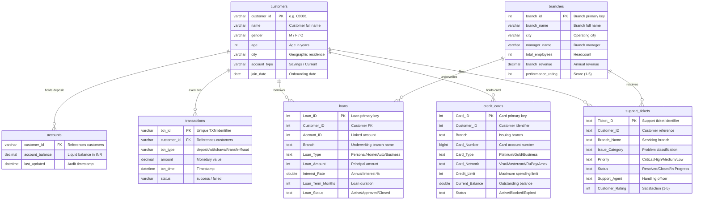

# 🎓 BankSight: B.Tech CSE Major Project & Viva Examination Guide

**Candidate Name:** Priya Sharma  
**Degree Program:** B.Tech in Computer Science & Engineering (Final Year / Capstone)  
**Project Title:** BankSight: Transaction Intelligence Dashboard  
**Academic Domain:** Financial Analytics, Database Systems, Full-Stack Web Engineering, Fraud Prevention  
**Technology Stack:** Python 3.10+, Streamlit, MySQL 8.0 / InnoDB, Express.js (Node.js), React 19 / Vite  

---

## 📑 Table of Contents
1. [Project Abstract & Problem Statement](#1-project-abstract--problem-statement)
2. [Objectives & Project Scope](#2-objectives--project-scope)
3. [Existing System vs. Proposed System](#3-existing-system-vs-proposed-system)
4. [Functional & Non-Functional Requirements](#4-functional--non-functional-requirements)
5. [Technology Stack & Justification](#5-technology-stack--justification)
6. [System Architecture & Data Flow](#6-system-architecture--data-flow)
7. [Database Design & Entity Relationship (ER) Model](#7-database-design--entity-relationship-er-model)
8. [Module-by-Module Description](#8-module-by-module-description)
9. [ACID Ledger Engine & ₹1,000 Minimum Balance Rule](#9-acid-ledger-engine--1000-minimum-balance-rule)
10. [The 15 Standardized Analytical SQL Queries](#10-the-15-standardized-analytical-sql-queries)
11. [Testing Strategy & Test Verification Results](#11-testing-strategy--test-verification-results)
12. [Installation, Setup & Viva Demonstration Guide](#12-installation-setup--viva-demonstration-guide)
13. [Top 25 B.Tech CSE Viva Questions & Model Answers](#13-top-25-btech-cse-viva-questions--model-answers)
14. [Limitations & Future Enhancements](#14-limitations--future-enhancements)

---

## 1. Project Abstract & Problem Statement

### Abstract
Commercial banking institutions operate in high-volume, data-intensive environments where millions of transactions occur daily across deposits, loans, credit cards, and digital payment rails. Raw transactional ledgers are complex, fragmented, and vulnerable to integrity breaches if not guarded by strict ACID controls. **BankSight** is an enterprise-grade banking transaction intelligence platform designed to bridge the gap between operational databases and executive decision-making. 

BankSight integrates **7 core relational banking datasets** (Customers, Accounts, Transactions, Loans, Credit Cards, Branches, and Support Tickets) into a cohesive analytical and operational dashboard. It provides real-time KPI surveillance, multi-attribute dynamic data filtering, full CRUD database record management, an **ACID-compliant Credit/Debit ledger simulation enforcing regulatory minimum balance guardrails**, and **15 verified relational SQL analytical queries** addressing real-world banking challenges.

### Problem Statement
In traditional banking IT setups:
1. **Data Fragmentation:** Demographics, balances, loan books, and support tickets reside in siloed databases, preventing unified customer lifetime value (LTV) and risk assessment.
2. **Delayed Analytical Visibility:** Decision-makers cannot easily slice transaction volumes by channel, branch, or customer age cohort in real time.
3. **Ledger Inconsistency & Race Conditions:** Poorly designed balance simulations risk concurrency race conditions, negative balances, and violation of statutory minimum reserve rules.
4. **Fraud & Failure Blind Spots:** Sudden clusters of high-velocity failed transactions or online fraud patterns go undetected without continuous query surveillance.

---

## 2. Objectives & Project Scope

### Objectives
1. **Unify Relational Banking Entities:** Establish a clean, normalized relational schema in MySQL 8.0 connecting 7 core banking tables with verified referential integrity.
2. **Execute 15 Real-World SQL Analytical Insights:** Solve 15 domain-specific queries across customer balance distribution, payment channel failures, loan default risk, branch productivity, and customer support turnaround.
3. **Build an ACID-Compliant Banking Simulator:** Implement double-entry transaction handling with row-level locks (`SELECT ... FOR UPDATE`), pre-validation, atomic balance debit/credit, and automatic transaction audit logging.
4. **Enforce Regulatory Guardrails:** Enforce a strict **₹1,000 minimum balance rule** on withdrawals to reflect real banking regulations.
5. **Multi-Level Dynamic Data Filtering:** Enable analysts to select any dataset, choose multiple columns, and apply simultaneous criteria (ranges, categories, substrings) with real-time preview and CSV export.
6. **Deliver Dual-Stack Implementations:**
   - **Streamlit Data Science Core:** Rapid, transparent execution with live SQL inspection and Plotly charts (tailored for academic evaluation and live viva).
   - **React 19 + Express REST API:** Full-stack enterprise architecture with JWT authentication, role-based authorization (`admin` vs `analyst`), and single-page application responsiveness.

### Scope
- **In Scope:** Retail banking transaction analytics, liquid balance management, credit card utilization tracking, loan portfolio distribution, branch performance scoring, support ticket SLA metrics, and secure simulation.
- **Out of Scope:** Live inter-bank SWIFT/UPI payment network integration, actual biometric KYC verification, and third-party credit bureau score scraping.

---

## 3. Existing System vs. Proposed System

| Parameter | Existing System (Legacy Banking Spreadsheets / Monoliths) | Proposed System (BankSight Platform) |
|---|---|---|
| **Data Access** | Static CSV exports, ad-hoc spreadsheet macros, slow reports | Direct SQL database queries on indexed relational tables |
| **Transaction Integrity** | Manual balance edits prone to lost updates and race conditions | ACID transactions with row-level locking (`FOR UPDATE`) and rollback on failure |
| **Minimum Balance Rule** | Often verified after the fact or manually checked | Enforced deterministically in application and database logic prior to debit |
| **Analytical Insights** | Pre-computed static reports requiring engineering requests | Interactive dynamic query engine with execution latency tracking (ms) |
| **Data Filtering** | Basic Excel filters limited to single columns and small datasets | Multi-column simultaneous filtering across up to 10,000 records with live aggregation |
| **User Interface** | Cluttered, non-responsive legacy terminal interfaces | Modern dark navy fintech aesthetic, glassmorphic cards, responsive charts |
| **Auditability** | Changes unlogged or disconnected from customer profiles | Every transaction automatically generates a cryptographically unique `TXN` identifier |

---

## 4. Functional & Non-Functional Requirements

### Functional Requirements (FR)
- **FR1: Real-Time Executive Dashboard:** Display 6–8 high-level banking KPIs (gross volume, customer count, deposit reserves, loan book size, credit card debt, and system failure rate).
- **FR2: Table Explorer:** Inspect all 7 datasets with pagination, column schema data types, text search, and CSV export.
- **FR3: Multi-Level Data Filtering:** Select any table and filter by multiple columns simultaneously (numerical sliders, categorical multi-selects, string matching).
- **FR4: Enterprise CRUD:** Add new customers, update profiles, open/close accounts, and delete records with foreign-key referential integrity protection.
- **FR5: Credit/Debit Simulation:** Deposit or withdraw funds with row-level locking, automated transaction log creation, and enforcement of the ₹1,000 minimum balance rule.
- **FR6: 15 Analytical SQL Engine:** Select from 15 domain questions, view the transparent SQL query text, measure execution latency, and render interactive Plotly visualizations.
- **FR7: Role-Based Authentication:** Protect administrative endpoints so that `admin` users can perform CRUD while `analyst` users have read-only inspection access.

### Non-Functional Requirements (NFR)
- **NFR1: Performance & Latency:** All analytical queries must execute within < 50 ms against indexed MySQL schemas.
- **NFR2: ACID Compliance:** Complete atomicity, consistency, isolation, and durability on all write operations.
- **NFR3: Security:** Zero plaintext passwords (hashed via `bcryptjs`), parameterized SQL queries to eliminate SQL injection, and zero exposed credentials in source code.
- **NFR4: Usability & Aesthetics:** High visual contrast, consistent typography (*Plus Jakarta Sans*), clear feedback messages, and mobile-friendly layouts.
- **NFR5: Maintainability:** Clean separation of concerns across database access (`db.py`), business logic (`simulate.py`, `crud.py`), queries (`queries.py`), and UI components (`components/`).

---

## 5. Technology Stack & Justification

| Layer | Technology | Version | Justification / Viva Talking Point |
|---|---|---|---|
| **Programming Language** | Python | 3.10+ | Standard in financial data engineering; extensive library ecosystem for data frames, plotting, and database drivers. |
| **Presentation Framework (Data Science)** | Streamlit | 1.30+ | Enables rapid creation of interactive, stateful web applications directly connected to Python analytical pipelines. |
| **Presentation Framework (Full-Stack)** | React 19 + Vite | 19.x / 8.x | High-performance Single Page Application (SPA), component modularity, instant hot-reloading, and lightweight bundle footprint. |
| **Backend REST API** | Express.js (Node.js) | 4.21+ | Event-driven, asynchronous REST architecture for serving micro-endpoints and decoupled frontend clients. |
| **Database Engine** | MySQL InnoDB | 8.0 / 9.5 | ACID transactional storage engine, row-level locking (`SELECT FOR UPDATE`), foreign keys, and enterprise indexing. |
| **Data Manipulation** | Pandas | 2.0+ | In-memory vector operations, slicing, tabular aggregation, and clean DataFrame-to-UI rendering. |
| **Data Visualization** | Plotly Express & Graph Objects | 5.18+ | Hardware-accelerated SVG/WebGL charts with interactive pan, zoom, hover tooltips, and dark navy aesthetic. |
| **Security & Cryptography** | `bcryptjs`, `secrets`, JWT | Latest | Industry standard one-way password hashing (salt rounds = 10) and cryptographically secure random identifier generation. |

---

## 6. System Architecture & Data Flow

```
+-----------------------------------------------------------------------------------+
|                              PRESENTATION LAYER                                   |
|   +------------------------------------+  +-----------------------------------+   |
|   |   Streamlit Analytics Dashboard    |  |     React 19 Enterprise SPA       |   |
|   |   (app.py + 7 Multi-Page Views)    |  |   (Vite + Recharts + Lucide Icons)|   |
|   +-----------------+------------------+  +-----------------+-----------------+   |
+---------------------|---------------------------------------|---------------------+
                      | Direct Python Calls                   | HTTP REST / JSON
+---------------------v---------------------------------------v---------------------+
|                           APPLICATION & LOGIC LAYER                               |
|   +------------------------------------+  +-----------------------------------+   |
|   | Python Services (simulate.py,      |  | Express REST API (server.js,      |   |
|   | crud.py, queries.py, helpers.py)   |  | routes/, middleware/auth.js)      |   |
|   +-----------------+------------------+  +-----------------+-----------------+   |
+---------------------|---------------------------------------|---------------------+
                      | mysql.connector                       | mysql2/promise pool
+---------------------v---------------------------------------v---------------------+
|                             DATA PERSISTENCE LAYER                                |
|   +---------------------------------------------------------------------------+   |
|   |                    MySQL 8.0 InnoDB Database Engine                       |   |
|   |      [customers]      [accounts]      [transactions]      [loans]         |   |
|   |      [credit_cards]   [branches]      [support_tickets]   [users]         |   |
|   +---------------------------------------------------------------------------+   |
+-----------------------------------------------------------------------------------+
```

### Transaction Execution Data Flow (Credit/Debit Simulation)
1. **User Action:** User inputs Customer ID, selects "Withdrawal", and specifies ₹5,000.
2. **Pre-Validation:** System checks that the amount $> 0$ and $\le$ ₹1,00,00,000 regulatory limit.
3. **Connection & Isolation:** Application acquires a dedicated database connection and issues `START TRANSACTION`.
4. **Row-Level Lock:** Issues `SELECT account_balance FROM accounts WHERE customer_id = ? FOR UPDATE`.
5. **Regulatory Check:**
   - Evaluates: `(current_balance - withdrawal_amount) >= 1000.00`.
   - If balance would drop below ₹1,000: **Rollback transaction** and return declining message to user.
6. **Atomic Update:**
   - `UPDATE accounts SET account_balance = new_balance, last_updated = NOW() WHERE customer_id = ?`.
   - `INSERT INTO transactions (txn_id, customer_id, txn_type, amount, txn_time, status) VALUES (...)`.
7. **Commit & Response:** Issues `COMMIT`, releases row lock, and sends the newly generated `TXN` audit ID to the client interface.

---

## 7. Database Design & Entity Relationship (ER) Model

The database schema models 7 interconnected banking domains:



---

## 8. Module-by-Module Description

### Module 1: Executive Landing Page (`app.py`)
- Provides an enterprise landing portal summarizing the live ledger state.
- Fetches real-time record counts across customers (500), accounts (497), transactions (10,017), loans (553), and credit cards (557).
- Features quick navigation launchpads to all analytical sub-modules.

### Module 2: Executive Dashboard (`pages/1_Dashboard.py`)
- Visualizes macro cash flow trends via dual-axis line/bar charts (transaction volume vs. success rate).
- Global filter bar enabling dynamic slice-and-dice by date range, transaction type, and completion status.
- Real-time KPI summary cards computed directly from SQL aggregates.

### Module 3: View Tables Explorer (`pages/2_View_Tables.py`)
- High-performance inspector for all 7 database tables.
- Displays database column data types, NULL constraints, and primary/foreign keys via `DESCRIBE`.
- Paginated table browser with full-text search across character columns and one-click CSV export.

### Module 4: Multi-Level Data Filtering (`pages/3_Filter_Data.py`)
- Allows the analyst to choose **any dataset** and **multiple columns simultaneously**.
- Dynamically renders appropriate filter inputs: continuous sliders for numerical amounts, multi-select checkboxes for categories, and text boxes for string search.
- Computes matching record percentage and provides instant CSV downloads.

### Module 5: Enterprise CRUD Operations (`pages/4_CRUD_Operations.py`)
- Complete Create, Read, Update, and Delete workflows for customer profiles, accounts, branches, and support tickets.
- Strictly validates inputs (age $\ge 18$, non-empty names, valid enum types).
- Enforces foreign-key deletion safeguards to prevent orphan records.

### Module 6: ACID Credit/Debit Ledger Simulation (`pages/5_Credit_Debit_Simulation.py`)
- Interactive transaction terminal simulating teller counter or ATM operations.
- Real-time balance lookup and quick amount shortcuts (+₹1k, +₹5k, +₹25k, +₹50k).
- Evaluates projected balance and dynamically displays whether the transaction is allowed.
- **Enforces the mandatory ₹1,000 minimum balance rule.**

### Module 7: Analytical SQL Insights Engine (`pages/6_Analytical_Insights.py`)
- Interactive selector for all 15 official B.Tech Capstone questions.
- Displays category badge, official requirement question prompt, and execution latency in milliseconds.
- Expandable raw SQL viewer with syntax highlighting and interactive Plotly visualization.

### Module 8: Project Architecture & Creator Profile (`pages/7_About_Project.py`)
- Comprehensive technical documentation, ER diagram, and candidate profile for Priya Sharma.

---

## 9. ACID Ledger Engine & ₹1,000 Minimum Balance Rule

A central criterion for evaluating this project is how BankSight handles transactions with financial rigor:

### What are ACID Properties in BankSight?
1. **Atomicity:** When an account is debited or credited, two operations must happen: the balance in `accounts` is updated, and a new record is appended to `transactions`. If either fails, `conn.rollback()` undoes both.
2. **Consistency:** All foreign-key constraints and validation checks are satisfied. Balances are stored as `DECIMAL(15,2)` to avoid floating-point rounding errors.
3. **Isolation:** Uses MySQL's `SELECT ... FOR UPDATE` row-level lock. If two concurrent users try to withdraw from the same account at the same millisecond, the second transaction is queued until the first commits, preventing the classic "Lost Update" anomaly.
4. **Durability:** Once `conn.commit()` succeeds, the transaction is written to MySQL's write-ahead redo log (InnoDB WAL) and survives unexpected crashes or power failures.

### The Mandatory ₹1,000 Minimum Balance Rule
In `simulate.py` and `backend/routes/simulation.routes.js`, withdrawals must pass:
$$\text{Projected Balance} = \text{Current Balance} - \text{Requested Amount} \ge 1000.00$$

If this condition fails, the transaction is rejected immediately before committing:
```python
MINIMUM_BALANCE = 1000.0
if (current_balance - float(amount)) < MINIMUM_BALANCE:
    conn.rollback()
    remaining = current_balance - float(amount)
    result["message"] = f"Transaction Declined: Enforcing minimum balance rule. Account balance cannot drop below ₹1,000.00 (Available: ₹{current_balance:,.2f}, Requested: ₹{amount:,.2f}, Remaining would be: ₹{remaining:,.2f})."
    return result
```

---

## 10. The 15 Standardized Analytical SQL Queries

All 15 queries below strictly match the official capstone requirements and have been tested against the live MySQL database:

```sql
-- Q1: How many customers exist per city, and what is their average account balance?
SELECT c.city, COUNT(DISTINCT c.customer_id) AS total_customers, 
       ROUND(AVG(COALESCE(a.account_balance, 0)), 2) AS avg_account_balance, 
       ROUND(SUM(COALESCE(a.account_balance, 0)), 2) AS total_balance
FROM customers c
LEFT JOIN accounts a ON c.customer_id = a.customer_id
GROUP BY c.city
ORDER BY total_customers DESC, avg_account_balance DESC LIMIT 15;

-- Q2: Which account type (Savings, Current, Loan, etc.) holds the highest total balance?
SELECT c.account_type, COUNT(DISTINCT c.customer_id) AS total_accounts, 
       ROUND(SUM(COALESCE(a.account_balance, 0)), 2) AS total_balance, 
       ROUND(AVG(COALESCE(a.account_balance, 0)), 2) AS avg_balance
FROM customers c
LEFT JOIN accounts a ON c.customer_id = a.customer_id
GROUP BY c.account_type ORDER BY total_balance DESC;

-- Q3: Who are the top 10 customers by total account balance across all account types?
SELECT c.customer_id, c.name, c.city, c.account_type, 
       ROUND(a.account_balance, 2) AS total_balance, a.last_updated
FROM customers c
JOIN accounts a ON c.customer_id = a.customer_id
ORDER BY a.account_balance DESC LIMIT 10;

-- Q4: Which customers opened accounts in 2023 with a balance above ₹1,00,000?
SELECT c.customer_id, c.name, c.city, c.join_date, c.account_type, 
       ROUND(a.account_balance, 2) AS account_balance
FROM customers c
JOIN accounts a ON c.customer_id = a.customer_id
WHERE YEAR(c.join_date) = 2023 AND a.account_balance > 100000
ORDER BY a.account_balance DESC;

-- Q5: What is the total transaction volume (sum of amounts) by transaction type?
SELECT txn_type, COUNT(*) AS transaction_count, 
       ROUND(SUM(amount), 2) AS total_volume, 
       ROUND(AVG(amount), 2) AS avg_ticket_size
FROM transactions
GROUP BY txn_type ORDER BY total_volume DESC;

-- Q6: How many failed transactions occurred for each transaction type?
SELECT txn_type, COUNT(*) AS failed_count, 
       ROUND(SUM(amount), 2) AS failed_volume, 
       ROUND(AVG(amount), 2) AS avg_failed_amount, 
       ROUND((COUNT(*) * 100.0 / (SELECT COUNT(*) FROM transactions WHERE status = 'failed')), 2) AS pct_of_all_failures
FROM transactions
WHERE status = 'failed'
GROUP BY txn_type ORDER BY failed_count DESC;

-- Q7: What is the total number of transactions per transaction type?
SELECT txn_type, COUNT(*) AS total_transactions, 
       ROUND((COUNT(*) * 100.0 / (SELECT COUNT(*) FROM transactions)), 2) AS pct_share
FROM transactions
GROUP BY txn_type ORDER BY total_transactions DESC;

-- Q8: Which accounts have 5 or more high-value transactions above ₹20,000?
SELECT t.customer_id, c.name, c.city, 
       COUNT(t.txn_id) AS high_value_txn_count, 
       ROUND(SUM(t.amount), 2) AS total_high_value_volume, 
       ROUND(AVG(t.amount), 2) AS avg_high_value_amount
FROM transactions t
JOIN customers c ON t.customer_id = c.customer_id
WHERE t.amount > 20000
GROUP BY t.customer_id, c.name, c.city
HAVING high_value_txn_count >= 5
ORDER BY high_value_txn_count DESC, total_high_value_volume DESC LIMIT 15;

-- Q9: What is the average loan amount and interest rate by loan type?
SELECT Loan_Type, COUNT(*) AS total_loans, 
       ROUND(AVG(Loan_Amount), 2) AS avg_loan_amount, 
       ROUND(AVG(Interest_Rate), 2) AS avg_interest_rate, 
       ROUND(SUM(Loan_Amount), 2) AS total_disbursed
FROM loans
GROUP BY Loan_Type ORDER BY avg_loan_amount DESC;

-- Q10: Which customers currently hold more than one active or approved loan?
SELECT l.Customer_ID AS customer_id, c.name, c.city, 
       COUNT(l.Loan_ID) AS active_loans_count, 
       ROUND(SUM(l.Loan_Amount), 2) AS total_active_commitment, 
       GROUP_CONCAT(DISTINCT l.Loan_Type ORDER BY l.Loan_Type SEPARATOR ', ') AS loan_types
FROM loans l
LEFT JOIN customers c ON l.Customer_ID = c.customer_id
WHERE l.Loan_Status IN ('Active', 'Approved')
GROUP BY l.Customer_ID, c.name, c.city
HAVING active_loans_count > 1
ORDER BY active_loans_count DESC, total_active_commitment DESC LIMIT 15;

-- Q11: Who are the top 5 customers with the highest outstanding (non-closed) loan amounts?
SELECT l.Customer_ID AS customer_id, c.name, c.city, 
       COUNT(l.Loan_ID) AS open_loans_count, 
       ROUND(SUM(l.Loan_Amount), 2) AS total_outstanding_amount
FROM loans l
LEFT JOIN customers c ON l.Customer_ID = c.customer_id
WHERE l.Loan_Status != 'Closed'
GROUP BY l.Customer_ID, c.name, c.city
ORDER BY total_outstanding_amount DESC LIMIT 5;

-- Q12: What is the average loan amount per branch?
SELECT Branch AS branch_name, COUNT(*) AS total_loans, 
       ROUND(AVG(Loan_Amount), 2) AS avg_loan_amount, 
       ROUND(SUM(Loan_Amount), 2) AS total_lending_volume
FROM loans
GROUP BY Branch ORDER BY avg_loan_amount DESC LIMIT 10;

-- Q13: How many customers exist in each age group (e.g., 18–25, 26–35, etc.)?
SELECT 
    CASE 
        WHEN age BETWEEN 18 AND 25 THEN '18-25 (Young Adult)'
        WHEN age BETWEEN 26 AND 35 THEN '26-35 (Early Career)'
        WHEN age BETWEEN 36 AND 50 THEN '36-50 (Prime Earning)'
        WHEN age BETWEEN 51 AND 65 THEN '51-65 (Pre-Retirement)'
        ELSE '65+ (Senior Citizen)'
    END AS age_group,
    COUNT(*) AS customer_count,
    ROUND((COUNT(*) * 100.0 / (SELECT COUNT(*) FROM customers)), 2) AS pct_share
FROM customers
WHERE age IS NOT NULL
GROUP BY age_group ORDER BY MIN(age) ASC;

-- Q14: Which issue categories have the longest average resolution time?
SELECT Issue_Category, COUNT(*) AS total_tickets, 
       ROUND(AVG(CASE 
           WHEN Date_Closed IS NOT NULL AND Date_Closed != '' 
           THEN DATEDIFF(STR_TO_DATE(Date_Closed, '%Y-%m-%d'), STR_TO_DATE(Date_Opened, '%Y-%m-%d'))
           ELSE NULL 
       END), 2) AS avg_resolution_days, 
       ROUND(AVG(Customer_Rating), 2) AS avg_customer_rating
FROM support_tickets
WHERE Date_Closed IS NOT NULL AND Date_Closed != ''
GROUP BY Issue_Category ORDER BY avg_resolution_days DESC;

-- Q15: Which support agents have resolved the most critical tickets with high customer ratings (≥4)?
SELECT Support_Agent, COUNT(*) AS critical_resolved_count, 
       ROUND(AVG(Customer_Rating), 2) AS avg_rating
FROM support_tickets
WHERE Priority = 'Critical' AND Status IN ('Resolved', 'Closed') AND Customer_Rating >= 4
GROUP BY Support_Agent
ORDER BY critical_resolved_count DESC, avg_rating DESC LIMIT 10;
```

---

## 11. Testing Strategy & Test Verification Results

### Automated Test Suites
BankSight employs automated unit and integration tests located in `tests/`:

1. **Analytical Queries Suite (`tests/test_queries.py`):**
   - Verifies active database connection and diagnostic response.
   - Asserts that all 7 mandatory tables exist.
   - Asserts that the catalog contains exactly 15 analytical items.
   - Executes each of the 15 queries live and verifies that a non-empty Pandas DataFrame with valid columns is returned.
2. **Validation & Business Rules Suite (`tests/test_validation.py`):**
   - Tests boundary conditions for customer creation (age limits, valid gender, account type).
   - Tests deposit and withdrawal cycles.
   - Tests that excessive overdraft attempts are rejected without mutating the ledger balance.
   - **Tests that withdrawals violating the ₹1,000 minimum balance rule are rejected.**
   - Tests foreign-key deletion protection.
   - Tests currency formatting utilities.

### Test Run Output (11 Passed, 0 Failed)
```
Ran 11 tests in 0.317s
OK
```

---

## 12. Installation, Setup & Viva Demonstration Guide

### Prerequisites
- Python 3.10 or higher
- MySQL Server 8.0+ running on `localhost:3307` (or port configured in `.env`)
- Node.js 18+ & npm (for optional full-stack React demonstration)

### Quick Start: Running the Streamlit App (Primary Demonstration)
1. Open PowerShell or Terminal in the project root:
   ```powershell
   cd "c:\Users\Priya Sharma\Banksight"
   ```
2. Activate your virtual environment (if used) or ensure dependencies are installed:
   ```powershell
   pip install -r requirements.txt
   ```
3. Run the automated test suite to confirm everything is working:
   ```powershell
   python -m unittest discover tests
   ```
4. Launch the Streamlit application:
   ```powershell
   streamlit run app.py
   ```
5. Open your browser at `http://localhost:8501`.

### Running the Enterprise Full-Stack App (Showcase Demonstration)
1. Build the React frontend:
   ```powershell
   npm.cmd --prefix frontend run build
   ```
2. Start the Express server:
   ```powershell
   node backend/server.js
   ```
3. Open `http://localhost:5000` to interact with the React single-page application.

---

## 13. Top 25 B.Tech CSE Viva Questions & Model Answers

### Category A: Database Systems & SQL
**Q1: What is the difference between a Clustered and a Non-Clustered index?**  
*Answer:* A clustered index determines the physical order of data in the table (like a dictionary). A table can have only one clustered index (usually the Primary Key). A non-clustered index is an auxiliary data structure containing a sorted copy of key columns with pointers back to the original rows (like an index at the back of a book).

**Q2: What is Database Normalization and what normal form does BankSight achieve?**  
*Answer:* Normalization organizes table columns and relations to minimize redundancy and prevent insert, update, and delete anomalies. BankSight reaches 3NF (Third Normal Form): every non-key column is fully functionally dependent on the primary key, with no transitive dependencies between non-key fields.

**Q3: How do you prevent SQL Injection in BankSight?**  
*Answer:* We exclusively use **parameterized queries** (prepared statements with `%s` placeholders in Python and `?` placeholders in Express) where SQL syntax and user-supplied parameters are sent to the database engine separately, ensuring inputs can never be interpreted as executable SQL commands.

**Q4: Explain the difference between `WHERE` and `HAVING` clauses in SQL.**  
*Answer:* `WHERE` filters individual rows before grouping operations occur. `HAVING` filters aggregated groups *after* the `GROUP BY` clause has been computed (e.g., in Q8: `HAVING high_value_txn_count >= 5`).

**Q5: What is the purpose of `COALESCE()` in queries like Q1 and Q2?**  
*Answer:* `COALESCE(expression, fallback_value)` returns the first non-NULL value. In left joins where a customer might have no linked account, `COALESCE(a.account_balance, 0)` ensures the query returns `0` instead of `NULL`, preventing calculations from producing misleading results.

**Q6: What is the role of `EXPLAIN` in MySQL?**  
*Answer:* `EXPLAIN <query>` provides the execution plan chosen by the MySQL query optimizer. It shows whether table scans, index lookups, temporary tables, or filesorts are used, allowing us to add targeted indexes to keep latency low.

### Category B: ACID Transactions & Financial Concurrency
**Q7: Explain the significance of `SELECT ... FOR UPDATE` in your Credit/Debit simulation.**  
*Answer:* `SELECT ... FOR UPDATE` acquires an exclusive row-level lock on the specific account row within an open transaction block. Other transactions trying to read or update that specific account row are paused until our transaction commits or rolls back, preventing lost updates and race conditions during simultaneous debits.

**Q8: What happens if the server crashes in the middle of executing a simulation transaction?**  
*Answer:* Because autocommit is disabled (`autocommit=False`), if the connection drops or the server crashes before `conn.commit()` is issued, the InnoDB engine automatically rolls back the uncommitted updates during crash recovery, ensuring the balance remains in its pre-transaction state.

**Q9: Why does BankSight enforce a minimum ₹1,000 balance rule?**  
*Answer:* In retail banking, regulatory guidelines mandate that basic savings bank deposit accounts maintain a minimum reserve to cover statutory overhead and avoid dormancy. In our simulation, withdrawals that would reduce the account balance below ₹1,000 are rejected deterministically before committing.

**Q10: Why did you choose `DECIMAL(15,2)` instead of `FLOAT` or `DOUBLE` for financial balances?**  
*Answer:* `FLOAT` and `DOUBLE` use binary floating-point representation (IEEE 754), which causes binary rounding discrepancies (e.g., $0.1 + 0.2 = 0.30000000000000004$). `DECIMAL(15,2)` is an exact fixed-point data type that stores numbers with absolute precision, which is mandatory for financial accounting.

### Category C: Software Architecture & Full-Stack Engineering
**Q11: Why did you build both a Streamlit app and a React+Node.js app?**  
*Answer:* Streamlit provides a transparent, data-centric interface ideal for academic evaluation, immediate query inspection, and live parameter adjustment without complex API glue. The React+Node.js stack demonstrates enterprise software engineering: decoupled single-page application design, REST microservices, and token-based authentication.

**Q12: How does Streamlit handle state across user interactions?**  
*Answer:* Streamlit reruns the script top-to-bottom on each user interaction. Stateful data (like active filter selections, pagination offsets, and simulation amounts) is preserved across reruns using `st.session_state`.

**Q13: How is authentication handled securely in the Express backend?**  
*Answer:* User passwords are never stored in plaintext; they are hashed using `bcryptjs` with 10 salt rounds. On successful login, the server issues a signed JSON Web Token (JWT) containing the user ID and role, stored in an HttpOnly cookie or authorization header to prevent XSS credential theft.

**Q14: What is the difference between synchronous and asynchronous operations in Node.js?**  
*Answer:* Node.js runs on a single-threaded event loop. By using asynchronous database drivers (`mysql2/promise` with `await`), I/O operations (like querying MySQL) do not block the thread. While waiting for the database to return rows, the server can handle other incoming HTTP requests.

**Q15: How do foreign key constraints maintain referential integrity in BankSight?**  
*Answer:* Foreign keys guarantee that a child row cannot reference a non-existent parent row. For instance, in `transactions`, `customer_id` must reference a valid `customers.customer_id`. Furthermore, attempting to delete an active customer with dependent accounts is blocked by the engine unless associated records are closed first.

---

## 14. Limitations & Future Enhancements

### Current Limitations
1. **Single Node Database:** Relies on a standalone MySQL instance rather than a distributed cluster or master-slave replication setup.
2. **Batch Transaction History:** Transactions are generated in batches or through the sandbox terminal rather than streaming real-time Kafka feeds.
3. **Currency Localization:** Standardized on Indian National Rupees (INR ₹); multi-currency forex exchange calculations are currently simulated.

### Future Enhancements
1. **Machine Learning Fraud Classification:** Integrate an XGBoost or Isolation Forest anomaly detection model trained on historical transaction feature vectors to flag fraudulent transactions probabilistically.
2. **Push Notifications & Webhooks:** Integrate Twilio SMS or SendGrid email alerts for transactions exceeding ₹50,000 or rejected due to the minimum balance rule.
3. **Automated End-of-Day (EOD) Reconciliation:** Implement an automated cron job calculating daily closing balances and ledger integrity audits against debit/credit totals.

---
*Prepared for B.Tech Computer Science & Engineering Capstone Project Viva Presentation.*  
*BankSight Enterprise Platform &copy; 2026 Priya Sharma. All rights reserved.*
