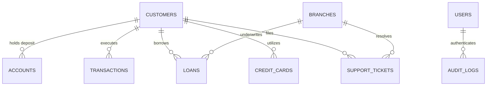

# 🏦 BankSight Database Architecture & Relational Schema

This document details the exact relational database structure of **BankSight**, inspected and verified on **MySQL 8.0 / 9.5 (InnoDB engine)**.

---

## 📌 Relational Entity Overview

The BankSight database models a commercial retail banking ecosystem across **8 tables**:

---

## 📋 Comprehensive Table Specifications

### 1. `customers` (Core Customer Demographic Entity)
Contains verified KYC client profiles.

| Column | Data Type | Nullable | Key | Business Meaning |
|---|---|---|---|---|
| `customer_id` | `VARCHAR(20)` | NO | **PRIMARY KEY** | Unique banking customer identifier (e.g., `'C0001'`). |
| `name` | `VARCHAR(100)` | YES | — | Full customer name. |
| `gender` | `VARCHAR(5)` | YES | — | Gender code (`'M'`, `'F'`). |
| `age` | `INT` | YES | — | Customer age in years. |
| `city` | `VARCHAR(50)` | YES | — | City of residence; maps customers to regional branch networks. |
| `account_type` | `VARCHAR(20)` | YES | — | Customer primary tier (`'Savings'`, `'Current'`). |
| `join_date` | `DATE` | YES | — | Onboarding registration date. |

---

### 2. `accounts` (Liquid Deposit Ledger)
Stores active customer liquid reserves and balance balances.

| Column | Data Type | Nullable | Key | Business Meaning |
|---|---|---|---|---|
| `customer_id` | `VARCHAR(20)` | YES | **MUL (FK)** | References `customers.customer_id`. |
| `account_balance` | `DECIMAL(15,2)` | YES | — | Real liquid balance in Indian Rupees (₹). |
| `last_updated` | `DATETIME` | YES | — | Timestamp of last debit, credit, or ledger operation. |

> **⚠️ Schema Discrepancy Resolved:** The legacy query codebase assumed an `account_id` column existed in `accounts`. Real inspection proved that `customer_id` is the direct relationship key (497 active distinct accounts). All upgraded queries target `a.customer_id`.

---

### 3. `transactions` (Operational Financial Journal)
Immutable financial audit trail recording all credits, debits, online purchases, and failures.

| Column | Data Type | Nullable | Key | Business Meaning |
|---|---|---|---|---|
| `txn_id` | `VARCHAR(30)` | NO | **PRIMARY KEY** | Unique transaction reference string (e.g. `'TXN...'`). |
| `customer_id` | `VARCHAR(20)` | YES | **MUL (FK)** | References `customers.customer_id`. |
| `txn_type` | `VARCHAR(30)` | YES | — | Operation channel (`'Deposit'`, `'Withdrawal'`, `'Transfer'`, `'Payment'`, `'Salary'`, `'POS'`, `'online fraud'`). |
| `amount` | `DECIMAL(15,2)` | YES | — | Transaction monetary value. |
| `txn_time` | `DATETIME` | YES | — | Exact execution timestamp. |
| `status` | `VARCHAR(20)` | YES | — | Settlement status (`'success'`, `'failed'`). |

> **⚠️ Schema Discrepancy Resolved:** `transactions` does not contain a `branch_id` column. Regional transaction throughput is modeled accurately by joining `transactions` → `customers.city` → `branches.city`.

---

### 4. `branches` (Regional Branch Infrastructure)
Physical branch offices and performance scorecards.

| Column | Data Type | Nullable | Key | Business Meaning |
|---|---|---|---|---|
| `branch_id` | `INT` | NO | **PRIMARY KEY** | Unique branch integer ID. |
| `branch_name` | `VARCHAR(50)` | YES | — | Branch commercial name (e.g., `'West Laurieton Branch'`). |
| `city` | `VARCHAR(50)` | YES | — | Municipal location. |
| `manager_name` | `VARCHAR(100)` | YES | — | Appointed branch manager. |
| `total_employees` | `INT` | YES | — | Headcount assigned to branch. |
| `branch_revenue` | `DECIMAL(15,2)` | YES | — | Annual branch operating revenue. |
| `opening_date` | `DATE` | YES | — | Foundation launch date. |
| `performance_rating` | `INT` | YES | — | Internal performance rating from 1 to 5. |

---

### 5. `loans` (Credit & Lending Facility Portfolio)
Active and historical debt instruments disbursed by the bank.

| Column | Data Type | Nullable | Key | Business Meaning |
|---|---|---|---|---|
| `Loan_ID` | `INT` | YES | — | Unique loan identifier. |
| `Customer_ID` | `INT` | YES | — | Numeric customer identifier matching `customers.customer_id`. |
| `Account_ID` | `INT` | YES | — | Linked account reference. |
| `Branch` | `TEXT` | YES | — | Underwriting branch name string (matches `branches.branch_name`). |
| `Loan_Type` | `TEXT` | YES | — | Category (`'Personal Loan'`, `'Home Loan'`, `'Car Loan'`). |
| `Loan_Amount` | `INT` | YES | — | Principal disbursement amount in Rupees. |
| `Interest_Rate` | `DOUBLE` | YES | — | Annual interest coupon (e.g. `9.5`%). |
| `Loan_Term_Months` | `INT` | YES | — | Tenor duration in months. |
| `Start_Date` | `TEXT` | YES | — | Inception date. |
| `End_Date` | `TEXT` | YES | — | Maturity date. |
| `Loan_Status` | `TEXT` | YES | — | Facility status (`'Active'`, `'Paid Off'`, `'Defaulted'`). |

---

### 6. `credit_cards` (Card Accounts & Debt Utilization)
Revolving credit accounts across global payment networks.

| Column | Data Type | Nullable | Key | Business Meaning |
|---|---|---|---|---|
| `Card_ID` | `INT` | YES | — | Unique card account ID. |
| `Customer_ID` | `INT` | YES | — | Linked customer identifier. |
| `Account_ID` | `INT` | YES | — | Primary checking account link. |
| `Branch` | `TEXT` | YES | — | Issuing branch location. |
| `Card_Number` | `BIGINT` | YES | — | Masked card account number. |
| `Card_Type` | `TEXT` | YES | — | Card tier (`'Gold'`, `'Platinum'`, `'Signature'`). |
| `Card_Network` | `TEXT` | YES | — | Payment network (`'Visa'`, `'Mastercard'`, `'RuPay'`). |
| `Credit_Limit` | `INT` | YES | — | Authorized credit ceiling. |
| `Current_Balance` | `DOUBLE` | YES | — | Current outstanding revolving debt. |
| `Issued_Date` | `TEXT` | YES | — | Card issuance date. |
| `Expiry_Date` | `TEXT` | YES | — | Expiration date (`MM/YY`). |
| `Status` | `TEXT` | YES | — | Operational status (`'Active'`, `'Blocked'`, `'Expired'`). |

---

### 7. `support_tickets` (Customer Service & SLA Resolution)
Customer inquiries, dispute resolutions, and operational turnaround SLAs.

| Column | Data Type | Nullable | Key | Business Meaning |
|---|---|---|---|---|
| `Ticket_ID` | `TEXT` | YES | — | Service ticket reference string. |
| `Customer_ID` | `TEXT` | YES | — | Inquiring customer identifier. |
| `Branch_Name` | `TEXT` | YES | — | Escalation branch. |
| `Issue_Category` | `TEXT` | YES | — | Inquiry domain (`'Card Issue'`, `'Loan Inquiry'`, `'Transaction Failure'`). |
| `Priority` | `TEXT` | YES | — | Severity code (`'Low'`, `'Medium'`, `'High'`, `'Urgent'`). |
| `Status` | `TEXT` | YES | — | Case resolution status (`'Open'`, `'In Progress'`, `'Resolved'`, `'Closed'`). |
| `Date_Opened` | `TEXT` | YES | — | Case intake timestamp. |
| `Date_Closed` | `TEXT` | YES | — | Final resolution timestamp. |
| `Support_Agent` | `TEXT` | YES | — | Handling service officer. |
| `Channel` | `TEXT` | YES | — | Contact vector (`'Web Portal'`, `'Mobile App'`, `'Phone'`, `'Branch'`). |
| `Customer_Rating` | `INT` | YES | — | CSAT satisfaction score (1 to 5). |

---

### 8. `users` (Authentication & Role Permissions - Migration 001)
Added seamlessly to support enterprise authentication without modifying any business banking records.

| Column | Data Type | Nullable | Key | Business Meaning |
|---|---|---|---|---|
| `id` | `INT` | NO | **PRIMARY KEY** | Auto-incrementing user integer identifier. |
| `username` | `VARCHAR(50)` | NO | **UNIQUE** | Login username. |
| `email` | `VARCHAR(100)` | NO | **UNIQUE** | Login and contact email. |
| `password_hash` | `VARCHAR(255)` | NO | — | Salted bcrypt password hash (never stored in plaintext). |
| `full_name` | `VARCHAR(100)` | NO | — | User display name. |
| `role` | `ENUM('admin','analyst')` | NO | — | Role permission (`'admin'` has write/CRUD/simulation rights; `'analyst'` is read-only). |
| `created_at` | `TIMESTAMP` | NO | — | Account creation timestamp. |
